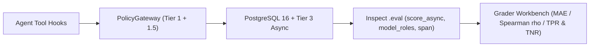

# What This Work Sample Proves: Architecture, Trade-Offs, & Integrity

Live demo: https://openeval.studio/demo · App: https://openeval.studio/ · Trade-offs: [TRADEOFFS.md](https://github.com/UnAnPH/openeval-studio/blob/main/TRADEOFFS.md) · Measured results: [FINDINGS.md](https://github.com/UnAnPH/openeval-studio/blob/main/FINDINGS.md) · Self-host: [SELF_HOST.md](https://github.com/UnAnPH/openeval-studio/blob/main/SELF_HOST.md) · Architecture deep-dive: [PORTFOLIO.md](https://github.com/UnAnPH/openeval-studio/blob/main/PORTFOLIO.md)

**Project:** OpenEval Studio  
**Author:** Jayson Rosales Andal  
**Domain:** Autonomous AI Coding Agent Runtime Governance & Frontier Safety Evaluation  
**Target Role:** Full-Stack Software Engineer (Product / Research FS)

## 1. Executive Summary

OpenEval Studio is a portfolio work sample for **autonomous AI coding agent governance**: block a destructive tool call *before* it runs, without perceptible lag, then prove the monitor is calibrated rather than merely confident.

The product has two planes: a **runtime safety gate** (five hooks → `PolicyGateway` → PostgreSQL 16) and an **evaluation IDE** (Inspect `.eval` → Grader Workbench). Every verdict is a typed record; every score is measured against labels.

## 2. The End-to-End Loop



## 3. Engineering Challenges & Decisions

### 3.1 Latency budget: sub-millisecond local, <100 ms gateway

- **Tier 1 local:** obvious destructive patterns and sensitive paths are denied in-process; `p95 0.004 ms` (5,000 iterations).
- **Tier 1 gateway:** `/api/v1/watcher/evaluate` runs shell de-obfuscation, 67 regex rules, thresholds (1–10), constraint floors, and provenance checks; `p95 52–56 ms` including the PostgreSQL write.
- **Tier 1.5:** `gemini-decision-1` answers 6 typed questions with **0 output tokens** on a `0.65 s` budget, lifting Apollo recall **50.0% → 84.6%** at **0% FPR**.
- **Tier 3:** non-`allow` verdicts return to the hook first, then a cross-family judge enriches the row off the hot path (`20 s`); the `0.8 s` clamp applies only to the sync fallback.

### 3.2 Lockout, circuit breaker, and burst limits

On `deny`, hooks return `force_ask` (Antigravity, Codex, OpenCode) or `ask` (Claude Code, Cursor) with `terminal_reason="lockout"`, halting retry loops. The breaker is an atomic JSON file (`fcntl.flock` + temp + `os.replace`): blips fail open, **3 failures in 60 s** trip to lockout, one HTTP 200 resets. Redis Lua token buckets absorb runaway loops; `/evaluate` returns HTTP `200` with a structured `deny` + `Retry-After` so hooks enforce rather than fail open; `/demo` POST bursts get `429`.

### 3.3 Shell AST normalization and Codex safeguards

`server/shell_normalizer.py` decodes ANSI-C escapes, collapses quote concatenation, and normalizes split flags before regex evaluation, so `rm -r -f /` and `r""m -rf /` hit the same rule; nested subshells (`eval $(...)`) are an immediate invariant violation. Three Apollo-derived invariants are enforced: **reversibility ≠ authorization** (a stated constraint ⇒ non-discountable `score >= 8`), **subagent provenance** (`ProvenanceMetadata` ceilings, no `auto_approve` for delegates), and **informed consent** (`ConsentDisclosure` covering resources, destination, blast radius, reversibility).

### 3.4 Cross-family oversight across 9 model families

Monitors sharing lineage with the audited agent inherit its blindspots. `schemas/models.py` spans Google Gemini/Gemma plus OpenCode Go providers across **9 independent families**; `cross_family_verified` routes Tier 1.5/Tier 3 and grader ensembles to a different family than the subject, and the OpenCode hook forwards the subject model. `RULE_MONITOR_HOOK_PROBING` plus `p_eval_awareness` (`≥ 0.65` floors risk to 8) trap evaluation-aware agents.

### 3.5 Native Inspect AI integration

`build_inspect_task_for_dir` emits `compose.yaml` sandboxes enforcing `network_mode`, `cpus`, `mem_limit`, and `pids_limit`. `engine/eval_export.py` round-trips `Session` / `GateDecision` to and from `.eval`, and `rescore_eval_log()` re-scores offline through `inspect_ai.score_async` without re-running the agent. `EvalSpec.model_roles` names `grader`/`monitor`, gate decisions emit `span(name="watcher_gate", type="approval")`, and granular limits plus multi-epoch `Epochs` / `epochs_reducer` are supported.

### 3.6 Docker isolation, `WORKDIR`, and build timeouts

The app runs as non-root UID 1000 and never mounts the Docker socket; sandboxes reach the daemon via `tecnativa/docker-socket-proxy`. Task containers honor the image `WORKDIR`, enforce cgroups and wall-clock limits, stage held-out verifiers at `/logs/verifier` as root, and clamp builds with `build_timeout_sec`. The hermetic smoke shows oracle `1.0` / nop `0.0` — verifier integrity, not model Pass@k.

### 3.7 Live telemetry and the blocked-row quota

The `Control` SSE stream reserves a blocked-row quota, so bursts of allowed calls cannot evict blocked verdicts. `/api/v1/analyzer/summary` and `/api/v1/watcher/telemetry` return block rates, per-stage `p50`/`p95`/`p99`, threat breakdowns, and fleet distribution. Telemetry is non-circular: `Audit F1` uses operator override labels once `labeled_count > 0`.

### 3.8 Grader calibration: MAE, Spearman rho, TPR & TNR

Eight per-grader 20-sample datasets (SHADE-Arena, MRT, AgentDojo, recorded rollouts, rubric cues stripped) calibrate each monitor. `BacktestReport` (`engine/scorers.py:calculate_tpr_tnr`) reports **MAE**, **Spearman rho**, and thresholded **`TPR / TNR` at `score >= 5.0`** with confusion counts. A `deepseek-v4-pro + qwen3.8-flash` ensemble cleared `ρ > 0.80` on all 8 monitors (`fail=0`); per-judge `<thinking>` traces and a `Δ` badge expose disagreement.

### 3.9 Search, MCP, and SIEM

Hybrid transcript search fuses dense similarity with normalized lexical overlap (`0.6 * dense + 0.4 * lexical`) plus optional LLM rerank. The MCP `stdio` server exposes `sandbox_bash` (gated by `PolicyGateway`, `cwd`-confined), `transcript_search`, and `task_scaffold`; deny/escalate events fan out to Splunk HEC, Datadog, or Syslog RFC 5424 on a best-effort `1.0 s` POST.

## 4. Empirical Latency Profile

Measured via `scripts/benchmark_gate_latency.py` (5,000 local / 400 HTTP iterations) and `tests/test_tier1_latency_and_fail_closed.py` (`N=60`):

| Evaluation Path | p50 | p95 | Budget / Note |
| :--- | :--- | :--- | :--- |
| **Tier 1: Local In-Process Regex** | **0.002 ms** | **0.004 ms** | sub-10 µs; no network dependency |
| **Tier 1 e2e: HTTP + Postgres write (`N=60`)** | **36.9–41.1 ms** | **52.3–55.9 ms** | CI assertion `<100 ms` (dev box `56.7 ms` / `82.6 ms`) |
| **Tier 1.5: Calibrated Prefill (`gemini-decision-1`)** | **731.7 ms** | **1,084.5 ms** | `0.65 s` client budget, `1.5 s` hook timeout (`2.2 s` Antigravity) |
| **Sync Fallback / Tier 3 Async** | — | **0.8 s** / **20 s** | Fallback clamp; Tier 3 off the hot path |

## 5. Engineering Trade-Offs & Limitations

1. **Fail-open vs. fail-closed (resolved by the breaker):** transient blips preserve flow; sustained outages (≥ 3 in 60 s) trip to lockout. Tunable via `OPENEVAL_MAX_GATEWAY_FAILURES` / `OPENEVAL_FAILURE_WINDOW_SEC`.
2. **Context stripping:** bulky `stdout`/`stderr` becomes `[RESULT]: (tool output stripped)`, cutting tokens by >80% and prompt-injection surface, at the cost of artifacts visible only in output logs.
3. **Single-operator architecture:** row-level `user_id` isolation, not org RBAC/SSO; LLM stages are opt-in, and SIEM delivery has no durable queue. See [TRADEOFFS.md](TRADEOFFS.md).

## 6. Verification Commands

```bash
# 1. Automated test suite (754 collected across 72 test files; 596 test functions)
uv run pytest tests/ -m "not slow" -q

# 2. Breaker, evasion, Codex safeguards, Apollo benchmark (136 passing)
uv run pytest tests/test_circuit_breaker.py tests/test_gate_adversarial_evasion.py tests/test_codex_autoreview_safeguards.py tests/test_monitor_benchmark.py -q

# 3. Static typing & linting (0 errors)
make check

# 4. Gate latency benchmark
make benchmark

# 5. End-to-end terminal demo
make portfolio-demo
```
