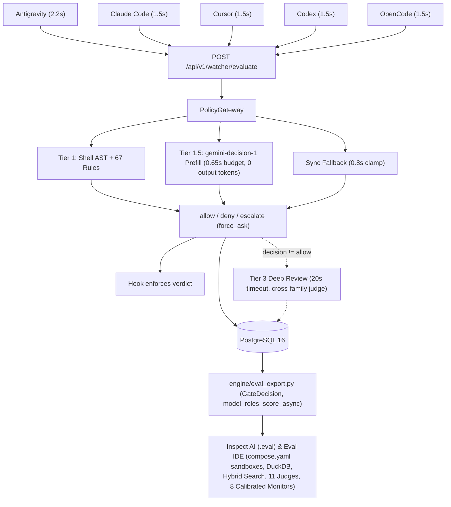

# OpenEval Studio

**OpenEval Studio** pairs a **Watcher-style pre-execution runtime safety gate** for five coding agents (`Antigravity`, `Claude Code`, `Cursor`, `Codex`, `OpenCode`) with a **UK AISI Inspect AI Evaluation IDE and Grader Workbench**. Hooks evaluate tool calls before they run, persist typed `GateDecision` / `ReviewRecord` rows in PostgreSQL 16 and export sessions losslessly to Inspect `.eval` logs for replay, search, diffs, and multi-judge calibration.

Live demo: https://openeval.studio/demo · App: https://openeval.studio/ · Trade-offs: [TRADEOFFS.md](https://github.com/UnAnPH/openeval-studio/blob/main/TRADEOFFS.md) · Measured results: [FINDINGS.md](https://github.com/UnAnPH/openeval-studio/blob/main/FINDINGS.md) · Self-host: [SELF_HOST.md](https://github.com/UnAnPH/openeval-studio/blob/main/SELF_HOST.md) · Architecture deep-dive: [PORTFOLIO.md](https://github.com/UnAnPH/openeval-studio/blob/main/PORTFOLIO.md)

## Architecture



- **Hot path vs. deep review (`server/routes/watcher_gate.py`, `server/policy_gateway.py`):** Tier 1 deterministic rules and Tier 1.5 calibrated prefill answer inside the hook timeout; the gateway persists the row and answers the hook first, then spawns **Tier 3 Deep Review** asynchronously with a cross-family judge. The `0.8s` clamp applies only to the synchronous fallback.
- **Typed live ↔ offline contract:** `engine/eval_export.py` round-trips `Session` / `GateDecision` to and from Inspect `EvalLog` (`.eval`), preserving provenance and consent metadata (`tests/test_gate_contract_roundtrip.py`).
- **Tenancy:** row-level `user_id` scoping on every store query, HMAC cookie or `Bearer oe_live_...` auth, and an isolated `/demo` tenant (reads + rate-limited eval launches).

## Features Implemented

### Runtime Safety Gate (`Safety`: `Control`, `Sessions`, `Policy`, `Hooks`)

- Unified Python/TS pre-execution hooks compiled from one `_hook_core.py` (`scripts/build_hooks.py`) across Antigravity, Claude Code, Cursor, Codex, and OpenCode, with an atomic `fcntl.flock` sliding-window circuit breaker (`3` failures in `60s` → `force_ask`/`ask`) and private `~/.openeval/locks` flags.
- Enforce / Observe (`shadow_decision`) / Paused modes, an SSE `Control` stream with a guaranteed blocked-row quota (bursts of allowed calls cannot evict blocked verdicts), single and bulk operator overrides, unclipped payload inspection, and 2 active `LIVE` demo sessions in `Sessions & Firewall`.
- Deterministic + calibrated gating: pre-rule shell AST de-obfuscation (`server/shell_normalizer.py`), 67 regex command rules, 1–10 per-tool thresholds, configurable Custom Organization Instructions (empty by default), and 6-question zero-output-token `gemini-decision-1` prefill across Apollo's 13 threat categories (`engine/decision_client.py`).
- Adversarial evasion and Codex auto-review safeguards: encoded pipe and subprocess reflection trapping, the *Reversibility ≠ Authorization* negative-constraint floor (`score >= 8`), subagent `ProvenanceMetadata` ceilings, structured `ConsentDisclosure` terminal lockouts, `RULE_MONITOR_HOOK_PROBING` + `p_eval_awareness`, and cross-family verification (`cross_family_verified`).
- Per-tenant `PolicyGateway` isolation and Redis Lua sliding token-bucket rate limiting: HTTP `200` with a structured `deny` + `Retry-After` on `/evaluate` so hooks enforce rather than fail open, and HTTP `429` on `/demo` POST bursts.

### Eval IDE & Inspect AI Integration (`Evaluate`: `Overview`, `Benchmarks`, `Launch`, `Runs`, `Compare`, `Judges`)

- 20 Docker-isolated tasks in `tasks/` (honoring image `WORKDIR`, CPU/RAM/network cgroups, wall-clock and `build_timeout_sec` enforcement, root-staged held-out `/logs/verifier`) plus UK AISI `inspect_evals/*` benchmarks and rate-limited real evaluations runnable from `/demo` (`eval-build-pov-ray` shown first).
- Native Inspect AI integration (`engine/inspect_bridge.py`, `engine/eval_export.py`): generated `compose.yaml` sandboxes enforcing `network_mode`/`cpus`/`mem_limit`/`pids_limit`, lossless `Session`/`GateDecision` ↔ `.eval` round-trips, `rescore_eval_log()` offline re-scoring via `inspect_ai.score_async`, `EvalSpec.model_roles` (`grader`/`monitor`), `span(name="watcher_gate", type="approval")` spans, granular limits (`message_limit`, `working_limit`, `token_limit`), and multi-epoch `Epochs` / `epochs_reducer` support.
- Live turn-by-turn SSE trajectory streaming, clickable `Go to Turn #N` audit navigation, same-task side-by-side diffs (`TrajectoryDiffEngine`), Fleet Analyzer (`DashboardOverview` across `Today`–`This month` with non-circular `Audit F1`), and SFT trajectory export.

### Grader Workbench & Calibration

- 11 canonical C1–C15 judges across 3 categories, cross-family GLM/DeepSeek audit judge routing (`select_independent_judge_model`) with explicit provider resolution, and a Gemini + Claude default ensemble (`gemini-4-hydrogen` + `opencode/claude-haiku-5-5`).
- Golden Benchmark calibration (default tab, beside `Session Audit`) over 8 per-grader 20-sample datasets, reporting **MAE**, **Spearman rho**, and thresholded **`TPR / TNR` (`score >= 5`)** confusion metrics (`BacktestReport`), plus per-judge `<thinking>` traces and `Delta` badges.

### Search, MCP & Security Integrations

- Hybrid transcript search (`0.6 * dense + 0.4 * lexical` with optional LLM rerank), an MCP JSON-RPC `stdio` server (`sandbox_bash` gated by `PolicyGateway`, `cwd` workspace confinement, network-less read-only Docker container by default, `transcript_search`, `task_scaffold`), and best-effort SIEM export (Splunk HEC, Datadog, Syslog RFC 5424).

## Technologies Used

| Layer | Technologies |
| --- | --- |
| **API & Policy Gateway** | Python 3.12, FastAPI, Uvicorn, Pydantic v2 |
| **Storage & Caching** | PostgreSQL 16 + SQLAlchemy + Alembic, DuckDB (`.eval` analytics), Redis (SSE bus + Lua token bucket; in-process fallback) |
| **Eval & Model Tooling** | UK AISI `inspect-ai` / `inspect-evals`, Google GenAI (`gemini-decision-1`), LiteLLM + OpenCode Go (9 model families), MCP `stdio` |
| **Agent Hooks & Sandboxes** | Generated Python/TS hooks (`scripts/build_hooks.py`), `fcntl.flock` circuit breaker, Docker + `tecnativa/docker-socket-proxy` |
| **Frontend** | React 19, TypeScript, Vite, Tailwind CSS, Lucide |
| **Infra & Quality Gates** | Docker Compose (5 prod services), Caddy (TLS), Terraform (AWS), GitHub Actions + Trivy, `ruff`, `pyright`, `pytest`, `tsc` |

## Work in Progress

- Unifying the web UI's local Docker eval runner onto Inspect AI's native `compose.yaml` + streaming `Transcript` events; the CLI `inspect eval` already uses `compose.yaml`, while the UI runs `ReActAgent` + `DockerSandbox` for per-turn SSE.
- A durable async queue and retry pipeline for SIEM webhook delivery (today a best-effort synchronous `1.0s` POST).
- True BM25 lexical scoring in hybrid transcript search (currently normalized term overlap) and multi-epoch `pass@k` sweep controls in the web UI.
- Organizational RBAC / SSO and multi-replica session coordination beyond single-operator row-level `user_id` scoping.

## Run Locally

```bash
docker compose up -d postgres redis          # PostgreSQL 16 + Redis
uv sync --extra dev
uv run alembic upgrade head
cd ui && npm install && npm run build && cd ..
uv run uvicorn server.app:app --port 8000    # API + built UI
```

```bash
make check                                   # hooks parity + ruff + format + pyright
uv run pytest tests/ -m "not slow" -q        # fast test suite
make benchmark                               # gate latency profile
```

Set `OPENEVAL_DEMO_SEED=1` only if you want the curated `/demo` tenant populated.

**Author:** Jayson Rosales Andal · [LinkedIn](https://linkedin.com/in/jaysonandal)
