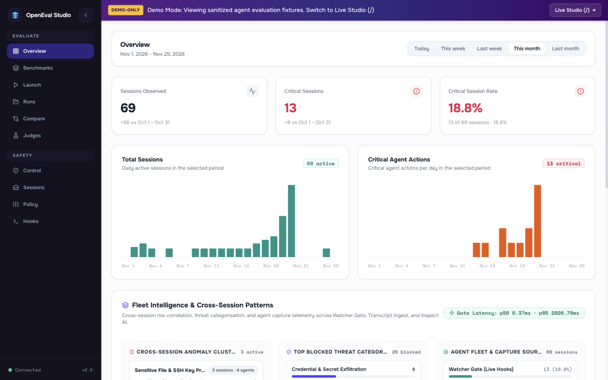
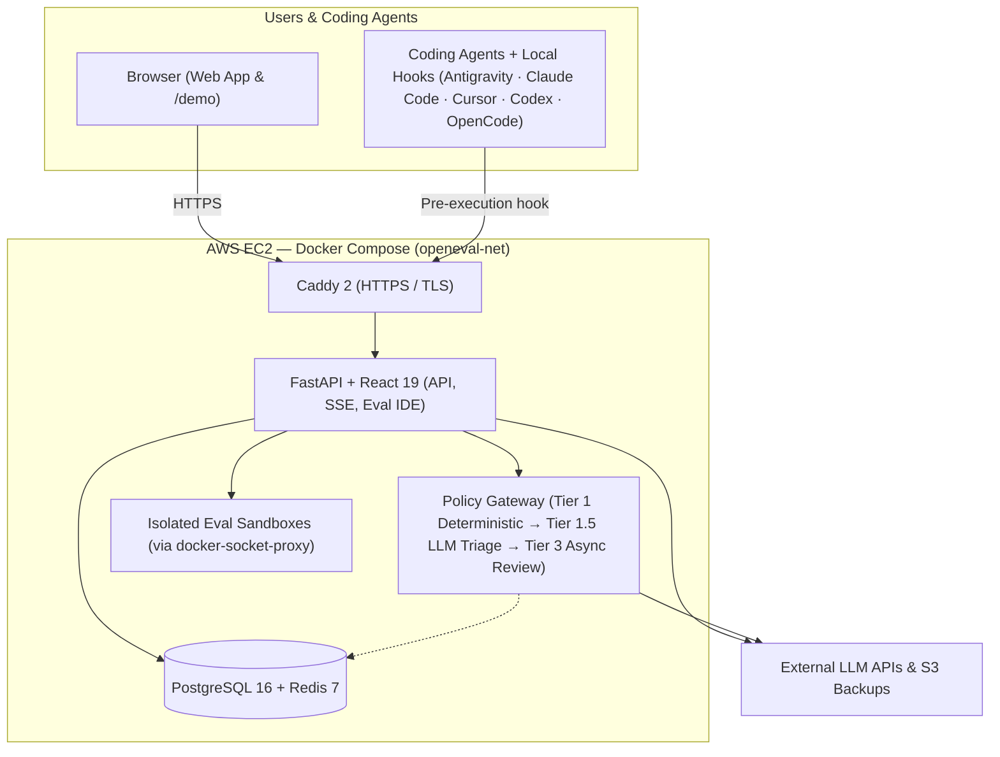

<div align="center">

# OpenEval Studio

**An open-source pre-execution runtime safety gate for coding agents, paired with a UK AISI Inspect AI evaluation IDE and grader workbench.**

**[Live Demo](https://openeval.studio/demo)** · **[Live App](https://openeval.studio/)**

<br />

<a href="https://openeval.studio/demo">
  
</a>

<br />

[About](#about) · [Features](#features) · [Architecture](#architecture) · [Tech Stack](#tech-stack) · [Getting Started](#getting-started) · [Work in Progress](#work-in-progress)

</div>

---

## About

**OpenEval Studio** brings runtime coding-agent security and evaluations into one workspace. Lightweight **agent-side hooks** enforce a low-latency **pre-execution blocking path** with graceful degradation across **Antigravity, Claude Code, Cursor, Codex, and OpenCode**, while unified **ingestion and grading pipelines** log every decision to PostgreSQL for **UK AISI Inspect** evaluation, run comparison, and monitor backtesting.

You can explore the hosted [`/demo`](https://openeval.studio/demo) workspace directly (including running evaluations and judge audits), use the hosted app, or deploy it **on-prem / locally** with Docker. Mutating live gate modes, policy rules, and API keys requires signing in or running locally.

---

## Features

### Evaluation IDE (`Overview` · `Benchmarks` · `Launch` · `Runs` · `Compare` · `Judges`)
- **Overview:** Organization-wide fleet view with session counts, critical session rates, `p50`/`p95` gate latency, cross-session pattern detection, top blocked threat categories, and a *Sessions to Review* queue.
- **Benchmarks & Launch:** 20 Docker-isolated tasks plus 10 UK AISI `inspect_evals` benchmarks with live results streaming, scorecards, and automated safety audits.
- **Runs:** Filter runs by benchmark, model, or ID; inspect full evaluation transcripts with fragment search (`LLM + BM25`), held-out verifier outputs, code diffs, and safety audit reports; override pass/fail outcomes or export Markdown reports and SFT JSONL.
- **Compare:** Side-by-side run comparison showing how trajectories, scores, and file writes differ across two runs on the same task.
- **Judges:** Edit rubrics across 11 LLM-as-judge monitors, run monitor backtesting (`MAE`, `Spearman ρ`, `TPR / TNR`), compare multi-judge ensembles with reasoning traces, and audit individual sessions.

### Runtime Safety Gate (`Control` · `Sessions` · `Policy` · `Hooks`)
- **Control:** Switch live gate mode (`Enforce` / `Observe` / `Paused`), stream real-time interceptions on the pre-execution blocking path, and approve or dismiss blocked calls.
- **Sessions:** View and analyze live and historical coding-agent sessions, run transcript fragment search (`LLM + BM25`), and upload JSONL logs in-browser.
- **Policy:** Configure org-wide guardrails — pre-rule shell AST de-obfuscation plus `67` built-in regex rules (toggle or add custom rules), per-tool risk thresholds (`1–10`), and custom instructions.
- **Hooks:** One-line agent-side hook installers for Antigravity, Claude Code, Cursor, Codex, and OpenCode, with API key rotation and fail-closed circuit-breaker protection.

---

## Architecture



---

## Tech Stack

| Layer | Technologies |
| --- | --- |
| **Frontend** | React 19, TypeScript, Vite, Tailwind CSS, Lucide |
| **Backend & Policy Gateway** | Python 3.12, FastAPI, Uvicorn, Pydantic v2 |
| **Storage & Messaging** | PostgreSQL 16 (SQLAlchemy + Alembic), Redis 7 (SSE + rate limiter), DuckDB |
| **Eval & Model Layer** | UK AISI `inspect-ai` / `inspect-evals`, Google GenAI, LiteLLM + OpenCode Go, MCP `stdio` |
| **Cloud & Infra** | AWS (EC2, S3 nightly backups, Elastic IP), Terraform, Docker Compose, Caddy, `tecnativa/docker-socket-proxy`, GitHub Actions + GHCR |
| **Quality & Testing** | `ruff`, `pyright`, `pytest`, `tsc` |

---

## Getting Started

### Prerequisites
- Python 3.12+ and [`uv`](https://docs.astral.sh/uv/)
- Node.js 20+ and `npm`
- Docker & Docker Compose (for PostgreSQL, Redis, and isolated benchmark sandboxes)

### 1. Clone & Configure
```bash
git clone https://github.com/UnAnPH/openeval-studio.git
cd openeval-studio
cp .env.example .env   # add GEMINI_API_KEY / OPENCODE_API_KEY for optional LLM tiers
```

### 2. Start Infrastructure & Install Dependencies
```bash
docker compose up -d postgres redis
uv sync --extra dev
uv run alembic upgrade head
cd ui && npm install && npm run build && cd ..
```

### 3. Run Locally
```bash
uv run uvicorn server.app:app --port 8000
```
Open `http://localhost:8000` in your browser. Set `OPENEVAL_DEMO_SEED=1` in `.env` if you want the curated `/demo` tenant populated.

### 4. Run Checks & Tests
```bash
make check                              # hook parity, ruff, format, pyright
uv run pytest tests/ -m "not slow" -q   # fast test suite
```

---

## Work in Progress

- [ ] Train smaller open-weight safety judges on exported failure trajectories and benchmark them against prompted models on accuracy, latency, and cost.
- [ ] Run Training-Run Assessments (TRAs) by comparing intermediate RL checkpoints inside **Compare** and **Judges** to track shifts in evaluation awareness, reward-seeking, and reasoning faithfulness over training.
- [ ] Add an agentic log reviewer that scans historical sessions for new failure patterns and proposes policy rules or regression test cases.
- [ ] Route local benchmark runs through native Inspect `compose.yaml` sandboxes with live UI streaming, add shared transcript annotations, and move log ingestion to async batching.

---

## License

Distributed under the MIT License. See [`LICENSE`](LICENSE) for details.

**Author:** Jayson Rosales Andal · [LinkedIn](https://linkedin.com/in/jaysonandal)
